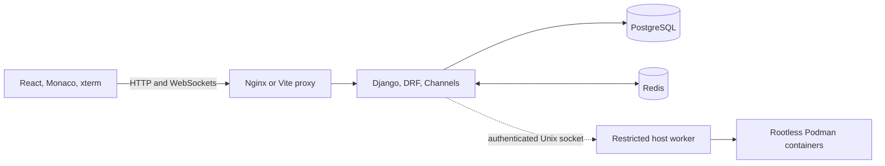

<div align="center">

# Shared_IDE

### Spark Lab · A collaborative browser-based development environment

**Write code together. Share files securely. Collaborate in real time.**

[](frontend/package.json)
[](backend/requirements.txt)
[](compose.yaml)
[](compose.yaml)

[Features](#features) · [Quick start](#quick-start) · [Architecture](#tech-stack-and-architecture) · [API](#api-documentation) · [Contributing](#contributing)

</div>

---

## Overview

**Shared_IDE** is a collaborative browser-based IDE for organizing, editing, sharing, and running code. It combines a React and Monaco Editor workspace with a Django API, PostgreSQL persistence, and real-time file collaboration.

The **Spark Lab** interface includes dark and light themes, resizable panels, editor tabs, and an interactive terminal. Users own their workspaces and can share individual files with registered collaborators. Shared files open alongside private files, with live cursors, selections, presence, and file-level permissions.

### At a glance

| Build | Collaborate | Control access | Execute |
| :--- | :--- | :--- | :--- |
| Monaco editor, tabs, workspace explorer | Yjs live editing, cursors, presence | File-level invitations, view/edit permissions | Python, C and C++ with configured rootless Podman |

### Preview

<!-- Add a real screenshot to docs/images/ide-screenshot.png, then uncomment:

-->

<!-- Add a real recording to docs/images/collaboration-demo.gif, then uncomment:

-->

*Screenshots and a collaboration demo can be added here once those assets are available.*

> [!IMPORTANT]
> **Execution availability:** Execution is disabled until configured. Docker Compose can use the restricted rootless Podman host worker over an authenticated private Unix socket. See [execution setup](EXECUTION.md) for local/VPS setup, sandbox checks and live tests. Django never receives a Docker/Podman engine socket.

## Quick start

To run the web IDE and collaboration services locally with Docker Compose:

```bash
# From the repository root
cp -n .env.example .env
cp -n backend/.env.example backend/.env
```

Before starting, configure the database credentials in `.env` and set a strong `DJANGO_SECRET_KEY` in `backend/.env`. For local testing without SMTP, set `EMAIL_BACKEND=django.core.mail.backends.console.EmailBackend` in `backend/.env`.

```bash
docker compose up --build -d
docker compose ps
```

Open **http://localhost:8080**. See [Installation and development](#installation-and-development) for Google OAuth, host development, email verification, and complete setup details.

## Contents

- [Overview](#overview)
- [Quick start](#quick-start)
- [Features](#features)
- [Tech stack and architecture](#tech-stack-and-architecture)
- [Project structure](#project-structure)
- [Prerequisites](#prerequisites)
- [Installation and development](#installation-and-development)
- [Environment variables](#environment-variables)
- [Authentication](#authentication)
- [Collaboration and Redis](#collaboration-and-redis)
- [Code execution](#code-execution)
- [Production deployment](#production-deployment)
- [API documentation](#api-documentation)
- [Tests and continuous integration](#tests-and-continuous-integration)
- [Operations and troubleshooting](#operations-and-troubleshooting)
- [Contributing](#contributing)

---

## Features

### Workspace and editor

- Create, rename, and delete private workspaces.
- Manage files and recursively nested folders, including root-level files/folders.
- Create, rename, delete, open, edit, and save files through the existing API.
- Monaco Editor with syntax highlighting, configurable font size and word wrap, and editor diagnostics.
- Multiple file tabs, unsaved indicators, independent drafts, and editor view-state preservation.
- Filename/path search, Explorer context menus, and language-aware file icons.
- Filename-based language detection and automatic extensions for supported private-file Run workflows.
- Resizable Explorer and bottom panel; Terminal, Output, and Problems views.
- Persistent dark/light theme preferences, responsive layout, and reduced-motion support.
- Keyboard shortcuts: `Ctrl/Cmd+S` to save, `F5` to run, and `Ctrl/Cmd+B` to toggle the sidebar.

### Real-time collaboration

- Invite registered users to specific files with **Can view** or **Can edit** permission.
- Accept/decline incoming invitations and view/cancel outgoing invitations.
- **Shared With Me** and **Files I've Shared** in the workspace activity bar.
- Owner-managed collaborator permissions and access removal.
- Shared and private files in the same editor/tab system, identified by file UUIDs.
- Yjs/CRDT concurrent editing with durable PostgreSQL document state and IndexedDB recovery support.
- Live collaborator cursors, colored selections, hover/touch username labels, and online presence.
- WebSocket reconnection and Redis coordination across backend processes.
- File-scoped authorization: sharing does not expose the owner's whole workspace or terminal.
- Private execution snapshots for shared files, including the executed revision and a later-edit indicator.

### Authentication and account management

- Email/password signup, password validation, email verification, and resend cooldowns.
- Login using a username or email address.
- Google OAuth sign-in and explicit Google account linking.
- JWT access tokens in frontend memory, HttpOnly refresh cookies, CSRF protection, and session revocation.
- Forgot Password with expiring, single-use reset links.
- Account username/password changes with current-password or email-based confirmation where applicable.
- Google-linked users can set a local password while retaining their account and workspaces.
- Friendly frontend errors and optional privacy-filtered Sentry monitoring.

### Execution and terminal

- Python, C, and C++ execution inside isolated Podman containers when enabled.
- Automatic save before private-file Run; a failed save prevents execution.
- Interactive program input/output through xterm and WebSockets.
- Stop, clear, resize, collapse, and maximize controls.
- CPU, memory, process, filesystem, input/output, and timeout limits.
- Shared-file execution does not overwrite edits made after its snapshot was captured.

## Tech stack and architecture

| Area | Technologies |
| --- | --- |
| Frontend | React 19, Vite, React Router, Lucide React, CSS themes |
| Editor and terminal | Monaco Editor, xterm, xterm FitAddon |
| Collaboration | Yjs, y-monaco, y-protocols, y-indexeddb, Python pycrdt |
| Backend | Django 6, Django REST Framework, Django Channels, Daphne |
| Persistence | PostgreSQL 16, psycopg |
| Coordination/cache | Redis 7, channels-redis, Django Redis cache |
| Authentication | Simple JWT, Authlib, Google OAuth with PKCE, Django email/CSRF protection |
| Execution | Rootless Podman, Python/GCC images, PTYs |
| Deployment | Docker Compose, unprivileged Nginx, WhiteNoise |
| Monitoring | Sentry Django and React SDKs with custom sanitization |
| Tests | Django TestCase/DRF APITestCase, Vitest, React Testing Library, jsdom |
| CI | GitHub Actions with separate backend and frontend jobs |

Version declarations live in [backend/requirements.txt](backend/requirements.txt) and [frontend/package.json](frontend/package.json). The frontend lockfile records resolved npm dependencies.



PostgreSQL stores accounts, workspace ownership, files, invitations, and collaborative document state. Redis distributes notifications and shares cache state between backend processes. Each execution WebSocket owns a private runner/terminal session.

## Project structure

```text
Shared_IDE/
├── .github/workflows/tests.yml   # Backend/frontend CI and Redis integration
├── .env.example                 # Root Compose environment template
├── compose.yaml                 # Database, Redis, migrations, backend, frontend
├── Makefile                     # Development/deployment shortcuts
├── backend/
│   ├── manage.py
│   ├── requirements.txt
│   ├── Dockerfile
│   ├── .env.example
│   ├── Shared_IDE/               # Settings, HTTP/ASGI routing, health, monitoring
│   ├── accounts/                 # JWT sessions, OAuth, email, account management
│   │   ├── migrations/
│   │   ├── templates/accounts/email/
│   │   └── tests/
│   └── workspace/                # Workspace CRUD, sharing, CRDT, execution
│       ├── management/commands/
│       ├── migrations/
│       └── tests/
└── frontend/
    ├── README.md                # Additional frontend/authentication details
    ├── Dockerfile
    ├── nginx.conf
    ├── package.json
    ├── package-lock.json
    ├── vite.config.js
    ├── vitest.config.js
    └── src/
        ├── auth/                # Authentication provider and session state
        ├── collaboration/       # Yjs provider, recovery, remote cursors
        ├── components/          # Editor, Explorer, terminal, dialogs, sharing
        ├── pages/               # Auth, dashboard, workspace, account pages
        ├── lib/                 # API client, errors, themes, file helpers
        ├── test/                # Shared test setup and mocks
        └── *.css                # Spark Lab, IDE, account, sharing styles
```

## Prerequisites

Choose the workflow that fits your needs:

| Requirement | Docker Compose | Host development |
| --- | --- | --- |
| Git | To obtain the repository | To obtain the repository |
| Docker Engine + Compose plugin | Required | Optional; convenient for PostgreSQL/Redis |
| Python 3.13 | Supplied by backend image | Required; matches CI and Docker |
| Node.js 22 and npm | Supplied by frontend build image | Required; matches CI and Docker |
| PostgreSQL | Compose supplies version 16 | Required; Compose database can be reused |
| Redis | Compose supplies version 7 | Required for multiple backend processes |
| Rootless Podman on Linux | Optional host worker for execution | Required only for code execution |
| GNU Make | Optional shortcuts | Optional shortcuts |

The interactive runner uses Linux PTYs and resource limits. The complete Compose stack can be used without enabling the host runner.

Commands assume a POSIX shell. Unless a block changes directory, run it from the repository root. Obtain a local checkout using this repository's GitHub **Code** URL; no particular Git remote name or account is required.

## Installation and development

### Option A: Docker Compose

#### 1. Create environment files

For a new checkout:

```sh
cp -n .env.example .env
cp -n backend/.env.example backend/.env
```

Keep existing environment files if already configured. Before starting:

1. Set the database name/user/password in root `.env`.
2. Replace `DJANGO_SECRET_KEY` in `backend/.env` with a long, random private value.
3. Configure SMTP, or explicitly select console email for local development.
4. Replace Google credential placeholders if using OAuth; otherwise leave `GOOGLE_CLIENT_ID` and `GOOGLE_CLIENT_SECRET` empty.
5. Keep `APP_ORIGIN=http://localhost:8080` for the default local Docker deployment.

For local console email, put this in `backend/.env`:

```dotenv
EMAIL_BACKEND=django.core.mail.backends.console.EmailBackend
```

SMTP is the application's default. Example SMTP credentials do not deliver mail, and signup depends on a functioning email backend.

#### 2. Build and start

```sh
docker compose up --build -d
docker compose ps
```

Open **http://localhost:8080**.

| Service | Responsibility |
| --- | --- |
| `postgres` | PostgreSQL with the persistent `postgres_data` volume |
| `redis` | Private shared coordination/cache; no published host port |
| `migrate` | Applies Django migrations and exits |
| `backend` | Daphne serves Django HTTP and WebSockets internally on port 8000 |
| `frontend` | Built React application and Nginx proxy, exposed locally on port 8080 |

Backend startup waits for database/Redis health and successful migrations. Nginx serves React routes and proxies `/api/`, `/admin/`, and `/static/` to Django.

#### 3. Register and create a workspace

Register, verify the emailed link, then sign in and create a workspace. With console email enabled, retrieve the link from backend logs:

```sh
docker compose logs -f backend
```

Console email logs contain private verification/reset links; do not share them publicly. Google sign-in is available after configuring its OAuth client.

#### 4. Manage the local stack

```sh
docker compose logs -f backend frontend
docker compose run --rm migrate
docker compose exec backend python manage.py createsuperuser
docker compose stop
```

Rebuild after changing code or frontend build variables. Application source is not mounted for hot reload in this Compose configuration.

`docker compose stop` preserves data. Avoid `docker compose down -v` unless you intend to delete the database volume. Changing `.env` credentials does not update an already initialized PostgreSQL user's password.

### Option B: Host development with hot reload

#### 1. Start PostgreSQL

Prepare root and backend environment files as above, then:

```sh
docker compose up -d --wait postgres
```

Alternatively, use an existing development PostgreSQL server. Match the backend's credentials to that server. With the supplied Compose database, host Django connects to `127.0.0.1:55432` by default.

Update these values in `backend/.env` for Vite development:

```dotenv
DJANGO_DEBUG=true
DJANGO_ALLOWED_HOSTS=localhost,127.0.0.1
POSTGRES_HOST=127.0.0.1
POSTGRES_PORT=55432
FRONTEND_URL=http://localhost:5173
FRONTEND_ORIGINS=http://localhost:5173,http://127.0.0.1:5173
GOOGLE_FRONTEND_ORIGIN=http://localhost:5173
GOOGLE_REDIRECT_URI=http://localhost:5173/api/auth/google/callback/
AUTH_COOKIE_SECURE=false
REDIS_URL=
REDIS_REQUIRED=false
CODE_EXECUTION_ENABLED=false
```

Keep the database name/user/password consistent with root `.env`. The Redis opt-out above is for **one development backend process**. Prepare Podman before enabling execution.

#### 2. Install and run Django

```sh
python3.13 -m venv .venv
. .venv/bin/activate
python -m pip install -r backend/requirements.txt
cd backend
python manage.py migrate
python manage.py runserver
```

The backend listens at **http://127.0.0.1:8000**. Keep the virtual environment activated for subsequent backend commands.

#### 3. Install and run the frontend

In another terminal, from the repository root:

```sh
cp -n frontend/.env.example frontend/.env
cd frontend
npm ci
npm run dev
```

Open **http://localhost:5173**. Keep `VITE_API_URL=/api`: Vite forwards HTTP and WebSocket API requests to Django while keeping browser cookies on the frontend origin.

For another backend port, use the existing override:

```sh
DEV_API_TARGET=http://127.0.0.1:8001 npm run dev
```

Vite uses a strict port of 5173. Use one browser hostname consistently; direct cross-host requests between `localhost` and `127.0.0.1` can prevent authentication cookies from being sent.

## Environment variables

### Configuration files and precedence

| File | Used for |
| --- | --- |
| [Root `.env.example`](.env.example) → `.env` | Compose interpolation: database credentials, public origin/port, frontend build variables |
| [Backend `.env.example`](backend/.env.example) → `backend/.env` | Django secrets, SMTP, OAuth, host DB settings, runner, monitoring |
| [Frontend `.env.example`](frontend/.env.example) → `frontend/.env` | Local Vite API/monitoring configuration |

Django's loader preserves existing process environment values. Compose's explicit environment entries override `backend/.env`, including database host/port, Redis URL, public origins, Google callback, and the root `.env` execution switch.

Never put private credentials in `VITE_*` variables: they are included in browser-visible builds. Docker excludes frontend `.env` files and passes an explicit allowlist of public build arguments instead. Restart backend processes after runtime configuration changes; rebuild frontend assets after build-time changes.

### Core configuration

| Variable | Purpose |
| --- | --- |
| `DJANGO_SECRET_KEY`, `JWT_SIGNING_KEY` | Private signing secrets; JWT key optional |
| `DJANGO_DEBUG`, `DJANGO_ALLOWED_HOSTS` | Debug mode and trusted hosts |
| `POSTGRES_DB`, `POSTGRES_USER`, `POSTGRES_PASSWORD` | Database credentials |
| `POSTGRES_HOST`, `POSTGRES_PORT`, `POSTGRES_SSLMODE` | Database connection and TLS settings |
| `APP_ORIGIN`, `APP_HOSTS`, `APP_BIND`, `APP_PORT` | Compose public origin, hosts, and listener |
| `FRONTEND_URL`, `FRONTEND_ORIGINS` | Frontend links and allowed origins |
| `AUTH_COOKIE_SECURE`, `AUTH_COOKIE_SAMESITE` | Refresh-cookie security |
| `REDIS_URL`, `REDIS_REQUIRED` | Collaboration coordination |
| `CODE_EXECUTION_ENABLED` | Opt-in execution switch; root `.env` controls Compose, backend `.env` controls native Django |
| `VITE_API_URL` | Frontend API prefix, usually `/api` |

Use the provided `.env.example` files for exact values. Never commit secrets or expose them through `VITE_*` variables.

### Email

```dotenv
EMAIL_BACKEND=django.core.mail.backends.smtp.EmailBackend
EMAIL_HOST=smtp.example.com
EMAIL_PORT=587
EMAIL_USE_TLS=true
EMAIL_USE_SSL=false
EMAIL_TIMEOUT=10
EMAIL_HOST_USER=replace-with-smtp-username
EMAIL_HOST_PASSWORD=replace-with-smtp-password
DEFAULT_FROM_EMAIL=Shared IDE <noreply@example.com>
```

Use provider-authorized credentials and sender settings. STARTTLS and implicit SSL must not both be enabled. Gmail SMTP uses `smtp.gmail.com`; the Google OAuth client secret is not an SMTP password. Confirm real inbox delivery separately from automated tests. Console delivery is an explicit local-development choice, not a fallback on SMTP failure.

### Google and monitoring

| Variables | Purpose |
| --- | --- |
| `GOOGLE_CLIENT_ID`, `GOOGLE_CLIENT_SECRET` | Backend-only OAuth Web application credentials |
| `GOOGLE_FRONTEND_ORIGIN` | Trusted browser origin for the Google flow |
| `GOOGLE_REDIRECT_URI` | Exact public backend OAuth callback URL |
| `SENTRY_DSN`, `SENTRY_DISABLED` | Backend monitoring enablement; an empty DSN disables it |
| `SENTRY_ENVIRONMENT`, `SENTRY_RELEASE` | Deployment identifiers |
| `SENTRY_TRACES_SAMPLE_RATE` | Optional sampling; default 0, capped at 0.05 |
| `VITE_SENTRY_DSN`, `VITE_SENTRY_DISABLED` | Separate public frontend monitoring configuration |
| `VITE_SENTRY_ENVIRONMENT`, `VITE_SENTRY_RELEASE`, `VITE_SENTRY_TRACES_SAMPLE_RATE` | Frontend build metadata and sampling |

In Compose, frontend monitoring values come from root `.env`; backend monitoring values belong in `backend/.env`. Replay and breadcrumbs are disabled, and custom event/transport sanitization removes sensitive request context, credentials, source code, and terminal contents.

## Authentication

### Email/password registration and login

1. The frontend obtains CSRF protection from `/api/auth/csrf/`.
2. Registration validates username, email, password, and confirmation; creates an unverified account; and sends a verification email.
3. The user sees **Check your email**, verifies a single-use link valid for 30 minutes, then signs in.
4. Login accepts a username or email address. The API field is named `username` in either case.
5. The frontend holds the access token in memory. The backend sets an HttpOnly refresh cookie, and session restoration uses the refresh endpoint.

New unverified password accounts cannot log in or bypass verification through refresh. Logout and credential changes use the existing session revocation rules. Registration does not automatically authenticate the new password account.

### Google OAuth

Configure an OAuth **Web application** client and register the callback matching the browser-facing deployment:

| Setup | Authorized redirect URI |
| --- | --- |
| Compose locally | `http://localhost:8080/api/auth/google/callback/` |
| Vite locally | `http://localhost:5173/api/auth/google/callback/` |
| Public HTTPS | `https://your-domain.example/api/auth/google/callback/` |

The scheme, host, port, path, and trailing slash must match exactly. Compose derives the callback from root `APP_ORIGIN`; internal Docker hostnames are not valid browser-facing callbacks.

The backend handles state/PKCE validation and provider identity verification, creates or reuses the mapped account, establishes the refresh-cookie session, and redirects to React's `/auth/google/callback` finish page. Register the backend callback with Google, not the React finish route.

New Google accounts receive readable unique usernames and an unusable local password. They do not receive an additional signup-verification email. Matching email addresses alone never merge unrelated accounts; existing users can explicitly link Google through their account controls.

### Password reset and account changes

Forgot Password returns a generic response for registered and unknown emails. Reset links expire after 30 minutes, are single-use, and invalidate outstanding reset links/session credentials when consumed successfully. Resetting does not automatically sign the user in.

Verified Google-linked users can set their first local password through the email reset flow while retaining their Google identity and owned workspaces. Account settings also support username/password updates with current-password confirmation, or session-bound email proof for eligible passwordless Google accounts.

## Collaboration and Redis

### Share a file

1. Open an owned file and choose **Share** to invite a registered user.
2. Select Can view or Can edit.
3. The recipient accepts through **Invitations** in the activity bar.
4. Open the accepted file through **Shared Files**; it joins the normal editor tabs.
5. Owners can use **Manage collaborators** to change permissions, cancel pending requests, or remove access.

Viewers cannot edit. Editors only receive access to explicitly shared files. REST and WebSocket authorization remain file-scoped, and revocation blocks further writes and removes active access/presence. Execution input/output belongs only to the initiating user's execution socket.

### Coordination modes

| Mode | Redis requirement |
| --- | --- |
| Compose | `redis://redis:6379/0`, required, private Docker network |
| One host development process | Empty `REDIS_URL` can use the in-memory layer |
| Multiple backend processes | Same private Redis URL, PostgreSQL database, signing keys, and origin configuration in all processes |
| Isolated unit tests | Explicit `REDIS_URL=` and `REDIS_REQUIRED=false` |

Production requires Redis by default. Set `REDIS_REQUIRED=true` explicitly for multiple development processes too: the application cannot infer separately launched workers. It fails clearly when required configuration is missing and does not silently fall back to in-memory coordination during a Redis outage.

Compose's Redis hostname is not available to host Django. For multiple host processes, provision a loopback-only Redis instance, for example:

```sh
docker run -d --name shared-ide-dev-redis \
  -p 127.0.0.1:6379:6379 redis:7-alpine \
  redis-server --save "" --appendonly no
```

Set `REDIS_URL=redis://127.0.0.1:6379/0` and `REDIS_REQUIRED=true` in every host backend environment. Keep remote Redis private and configure credentials/TLS as appropriate.

The channel layer uses `socket_timeout=None` and `socket_connect_timeout=5` so idle blocking receives do not race a client read deadline. Do not add `socket_timeout` or `socket_connect_timeout` query parameters to `REDIS_URL`; settings reject them.

## Code execution

### Docker Compose: restricted host worker

Follow [EXECUTION.md](EXECUTION.md) before enabling execution. In brief:

```bash
make runner-setup
make runner-images
make runner-check
# Set CODE_EXECUTION_ENABLED=true and RUNNER_GID=<id -g> in root .env.
make up
make runner-test
```

`make up` starts the host worker when configured. `make stop` stops it alongside
Compose without removing database volumes. The worker is private, authenticated,
non-root and bounded; no container engine socket is mounted into Django.

### Native Django: local Podman

As the same OS user that runs Django:

```sh
podman info
make runner-images
make runner-images-check
```

The setup target pulls `docker.io/library/python:3.12-alpine` and `docker.io/library/gcc:14`. Set `CODE_EXECUTION_ENABLED=true` in the host backend environment, then restart Django.

Rootless and rootful Podman have separate image stores. Images pulled with `sudo podman` may be unavailable to an ordinary user running Django. Run requests check image availability; the default pull policy is `never`.

Optional existing overrides are `CODE_RUNNER_ENGINE`, `PYTHON_RUNNER_IMAGE`, `CPP_RUNNER_IMAGE`, and `CODE_RUNNER_PULL_POLICY`.

### Run behavior and limits

- Filename extensions take priority for language detection. Content detection is the fallback for extensionless files; ambiguous code requires an explicit supported-language choice.
- Private-file Run saves content, name, and language before execution and can assign the detected extension.
- Collaborative Run waits for synchronization and captures a server-side snapshot. It does not rename the shared file or write stale content back after execution.
- The executed revision and subsequent changes are displayed for shared runs.
- Each run executes one file. Other workspace files are not mounted, and there is no unrestricted shell/package-installation feature.
- Python, C, and C++ are the supported runners; syntax highlighting supports additional languages.

| Limit | Current implementation |
| --- | --- |
| Memory | 128 MiB for Python; 256 MiB for C/C++ |
| CPU allocation / process count | 0.5 CPU; 32 processes |
| Interactive wall-clock timeout | 60 seconds |
| Noninteractive REST deadline | 8 seconds |
| Output | 32 KiB |
| Interactive input | 64 KiB total, 4 KiB per chunk |
| Container restrictions | No networking, read-only root, non-root user, dropped capabilities, bounded temporary filesystems, CPU/file limits |

The Docker application container has no privileged runner access. Its optional host worker uses the same sandbox limits, a private authenticated protocol, bounded concurrency, crash cleanup and startup security checks. See [EXECUTION.md](EXECUTION.md).

## Production deployment

Build the Vite frontend and serve it through Nginx with Django/Daphne behind a trusted HTTPS reverse proxy. Provision PostgreSQL, private Redis, SMTP, backups, and strong secrets. Configure exact allowed hosts, frontend origins, secure cookies, and the Google callback URI.

```dotenv
APP_ORIGIN=https://ide.example.com
APP_HOSTS=ide.example.com
DJANGO_DEBUG=false
AUTH_COOKIE_SECURE=true
```

Start with `docker compose up --build -d`. TLS termination, trusted forwarded headers, certificates, and backups require deployment-specific setup; the Compose stack does not provide them automatically. Enable execution only after completing the [host worker setup and security checks](EXECUTION.md).

## API documentation

All paths below include their trailing slash. UUID placeholders represent workspace/file/folder/invitation IDs; collaborator `user_id` is an integer. Workspace/sharing routes require authenticated access and enforce ownership or file membership.

### Authentication

All routes in this table are relative to **`/api/auth/`**.

| Method | Route | Purpose |
| --- | --- | --- |
| GET | `csrf/` | Obtain CSRF protection |
| POST | `register/` | Register with `username`, `email`, `password`, `confirm_password` |
| POST | `verify-email/` | Consume a verification `token` |
| POST | `resend-verification/` | Request another verification email |
| POST | `login/` | Login with `username` (username or email) and `password` |
| POST | `refresh/` | Restore/rotate the refresh-cookie session |
| POST | `logout/` | Revoke/logout the current session |
| GET | `me/` | Current user information |
| POST | `google/start/` | Initiate Google sign-in |
| POST | `google/link/` | Initiate authenticated Google linking |
| GET | `google/callback/` | Provider OAuth callback |
| POST | `password-reset/` | Request a password-reset email |
| POST | `password-reset/confirm/` | Validate token and set a new password |
| POST | `account/verification/` | Request account-change proof for an eligible Google account |
| POST | `account/username/` | Change username with confirmation |
| POST | `account/password/` | Set/change password with confirmation |

Use the existing frontend API client for cookie credentials, CSRF headers, token refresh, and safe error handling. Access tokens belong in the `Authorization: Bearer …` header, not URLs or browser persistent storage.

### Workspaces, folders, and files

| Methods | Endpoint | Purpose |
| --- | --- | --- |
| GET, POST | `/api/workspaces/` | List/create owned workspaces |
| GET, PUT, PATCH, DELETE | `/api/workspaces/{workspace_id}/` | Recursive tree and workspace management |
| GET, POST | `/api/workspaces/{workspace_id}/folders/` | List/create folders |
| GET, PUT, PATCH, DELETE | `/api/workspaces/{workspace_id}/folders/{folder_id}/` | Folder management |
| GET, POST | `/api/workspaces/{workspace_id}/files/` | List/create files |
| GET, PUT, PATCH, DELETE | `/api/workspaces/{workspace_id}/files/{file_id}/` | File management |
| POST | `/api/workspaces/{workspace_id}/files/{file_id}/run/` | Owner-only noninteractive execution with request `content` |

The workspace comes from the URL when creating a file/folder. Omit `parent`/`folder`, or send `null`, for root items. Referenced folders must belong to the same workspace. Folder updates reject ancestor cycles.

Example root-file creation body:

```json
{
  "name": "main.py",
  "language": "python",
  "content": "print('Hello from Shared_IDE')",
  "folder": null
}
```

A recognized filename extension must match the `language` value. Private file updates can change `name`, `language`, or `content`; collaborative document content must use CRDT updates to avoid overwriting concurrent edits.

### Sharing

All routes in this table are relative to **`/api/sharing/`**.

| Methods | Route | Purpose |
| --- | --- | --- |
| GET | `users/?file={file_id}&q={query}` | Owner-authorized recipient lookup |
| GET | `files/` | Accepted files shared with the current user |
| GET | `files/?direction=owned` | Owned files with accepted collaborators |
| GET | `invitations/` | Pending incoming invitations |
| GET | `invitations/?direction=sent` | Sent invitation history |
| POST | `invitations/{invitation_id}/` | Action: `accept`, `decline`, or `cancel` |
| GET, PATCH | `files/{file_id}/` | Authorized file data / CRDT update |
| GET, POST | `files/{file_id}/manage/` | Owner management data / invite a recipient |
| PATCH, DELETE | `files/{file_id}/members/{user_id}/` | Owner permission changes/removal |

An invitation body uses a registered user's integer ID and `view` or `edit` permission, for example `{"recipient": 42, "permission": "edit"}`. Accepting uses `{"action": "accept"}` on the invitation endpoint.

### WebSockets

| Route | Purpose |
| --- | --- |
| `/api/collaboration/files/{file_id}/` | CRDT synchronization and presence |
| `/api/workspaces/{workspace_id}/files/{file_id}/run/` | Owner's interactive execution |
| `/api/sharing/files/{file_id}/run/` | Owner/editor's private shared-document execution |

Sockets use an initial authentication frame, server-side origin validation, and ongoing access checks. They do not accept JWTs in query strings. Reuse the implemented providers/consumers for message formats.

Source references: [auth routes](backend/accounts/urls.py), [workspace routes](backend/workspace/urls.py), [sharing routes](backend/workspace/sharing_urls.py), and [WebSocket routing](backend/workspace/routing.py).

## Tests and continuous integration

Tests use an isolated PostgreSQL test database. The development/test database user must be permitted to create it. Use test credentials rather than a production database role. Ordinary tests mock SMTP, Google responses, and Podman.

### Backend

With the virtual environment activated, from the repository root:

```sh
cd backend
SENTRY_DISABLED=true REDIS_URL= REDIS_REQUIRED=false \
  RUN_REDIS_INTEGRATION_TESTS=0 RUN_PODMAN_INTEGRATION_TESTS=0 \
  python manage.py test --noinput
```

Or use the built Compose backend:

```sh
docker compose up -d --wait postgres
docker compose build backend
docker compose run --rm --no-deps \
  -e SENTRY_DISABLED=true -e REDIS_URL= -e REDIS_REQUIRED=false \
  -e RUN_REDIS_INTEGRATION_TESTS=0 -e RUN_PODMAN_INTEGRATION_TESTS=0 \
  -e FRONTEND_ORIGINS=http://localhost:5173,http://127.0.0.1:5173 \
  backend python manage.py test --noinput
```

Backend tests cover models, serializers, authentication, ownership, recursive CRUD, language detection, execution, WebSockets, sharing, CRDT persistence, Redis configuration, and monitoring. Rebuild the image after changes before testing containerized source.

### Optional integration tests

Redis integration tests require a dedicated Redis test database; Podman integration tests require a prepared rootless Podman host. Both are opt-in. See the test modules under `backend/workspace/tests/` and the CI workflow for supported configurations.

### Frontend

```sh
cd frontend
npm ci
npm test
npm run lint
npm run build
```

`npm test` runs Vitest once; `npm run test:watch` enables watch mode. Tests use React Testing Library and mock Monaco, HTTP requests, and WebSockets where appropriate.

### GitHub Actions

[The workflow](.github/workflows/tests.yml) runs on every push and pull request. Backend and frontend jobs run independently. It provisions PostgreSQL and Redis, runs ordinary Django tests plus a separate Redis integration step, and runs frontend tests/builds. Live Podman execution and production OAuth/SMTP credentials are not required by standard CI.

## Operations and troubleshooting

- **Database:** Run `python backend/manage.py migrate` on the host or `docker compose run --rm migrate` in Compose. Back up PostgreSQL volumes before maintenance.
- **Health:** Django's `/healthz/` checks PostgreSQL; the public Nginx `/healthz` only checks the frontend proxy. Neither confirms Redis health.
- **Google OAuth issues:** Confirm the callback URI matches exactly, including scheme, port, path, and trailing slash.
- **CSRF/cookie issues:** Use a consistent hostname, matching frontend origins, and correct HTTPS cookie settings.
- **Redis issues:** Share the same private Redis instance across backend workers. Single-process development can opt out explicitly.
- **Execution unavailable:** Execution defaults to disabled. Configure the [restricted host worker](EXECUTION.md), run `make runner-check`, set the root `.env` flag/group, and use `make up`.
- **Frontend changes not appearing:** Rebuild Docker images; Compose does not mount frontend source for hot reload.

Useful Makefile shortcuts include `make up`, `make stop`, `make logs`, `make runback`, `make runfront`, `make migrate`, `make runner-images`, and `make runner-images-check`.

## Contributing

1. Read the relevant backend/frontend code and existing tests before changing behavior.
2. Work on a focused branch and describe the problem or feature in your pull request. Discuss substantial architecture changes before implementing them.
3. Reuse the existing API client, error handling, serializers, collaboration provider, and themed components.
4. Add regression tests for changed behavior. Keep ordinary unit tests independent of real SMTP, Google credentials, and Podman; use the opt-in integration checks for those supported runtime paths.
5. Run the affected backend/frontend tests and frontend lint/build as applicable. Include the commands, results, and any skipped integration checks in the pull request.
6. Include Django migrations for intentional schema changes; do not remove or rewrite existing migrations to make tests pass.
7. Update this README or the frontend guide when commands, environment variables, endpoints, or behavior change.

Preserve file/workspace authorization, CSRF protections, OAuth validation, JWT session checks, and runner isolation. Never commit `.env` files, credentials, database dumps, private source, or terminal transcripts. Do not include tokens, OAuth callback query strings, or verification links in bug reports.

For UI changes, include screenshots and check both themes, narrow layouts, keyboard access, and reduced-motion behavior. Preserve bundled third-party notices, including the [Google Sans font notice](frontend/src/assets/google-sans-LICENSE.txt).
